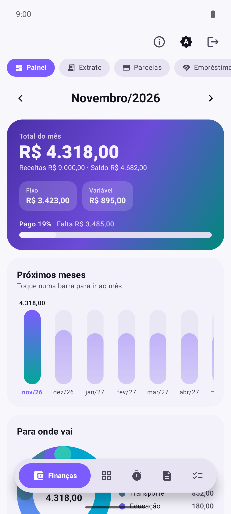
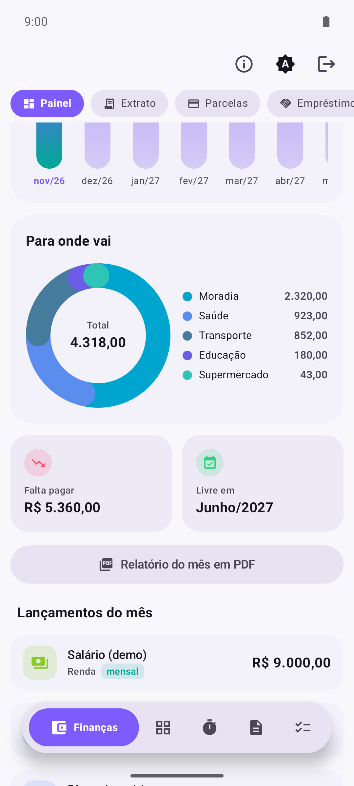
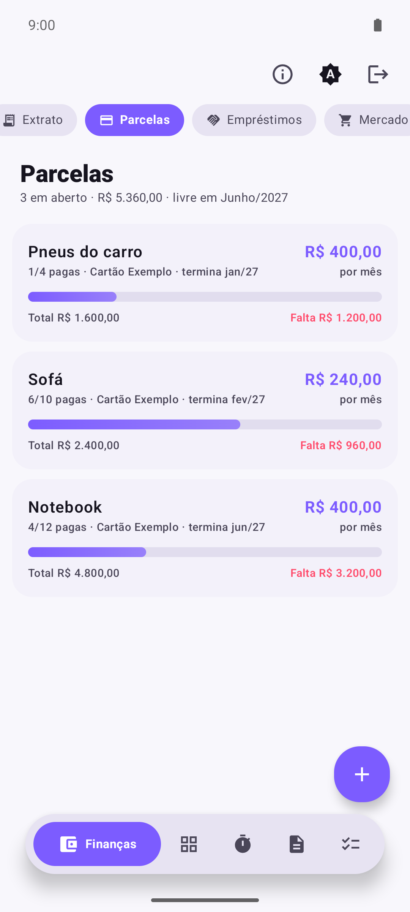
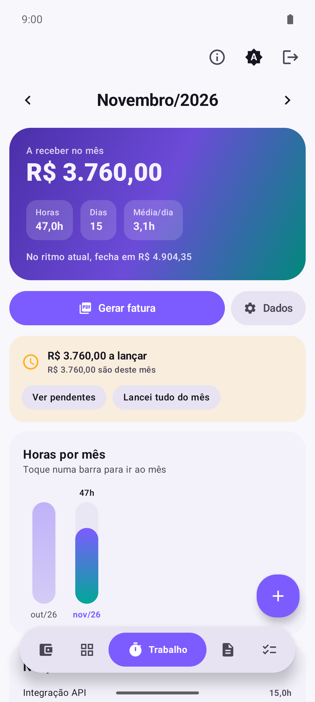
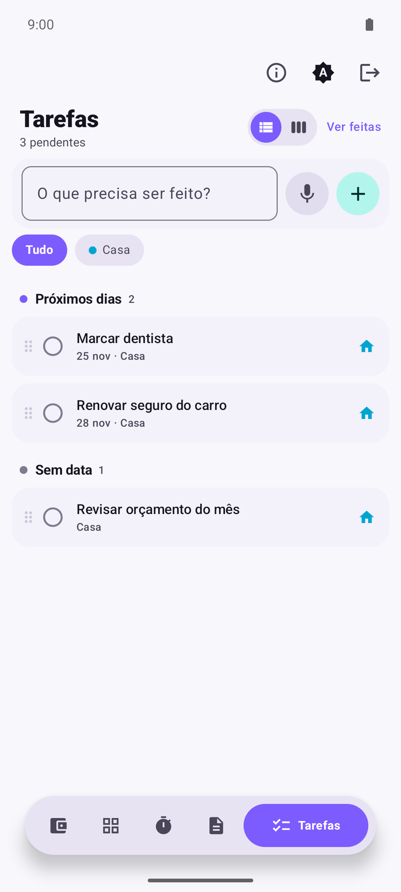

# Studio Project X

App pessoal com 5 módulos: finanças, hábitos, trabalho, orçamentos e tarefas. Criado por mim com desenvolvimento assistido por IA, guiado por especificação.

> O código-fonte é privado. Este repositório apresenta o projeto.

## Destaques
- Motor de projeção financeira validado contra a planilha original (21 testes só no motor).
- Widget no iOS (WidgetKit).

## Números
- Kotlin Multiplatform com 4 alvos: Android, iOS, Web e Desktop.
- Cerca de 84% do código compartilhado.
- Mais de 100 testes automatizados.

## Stack
Kotlin Multiplatform · Compose Multiplatform · Firebase · WidgetKit · IA com especificação (SDD e PRD)

## Telas (Android, dados de demonstração)

    

---
**English:** Personal productivity app with 5 modules (finance, habits, work, quotes, tasks). Kotlin Multiplatform (4 targets), ~84% shared code, financial projection engine validated against the original spreadsheet.
